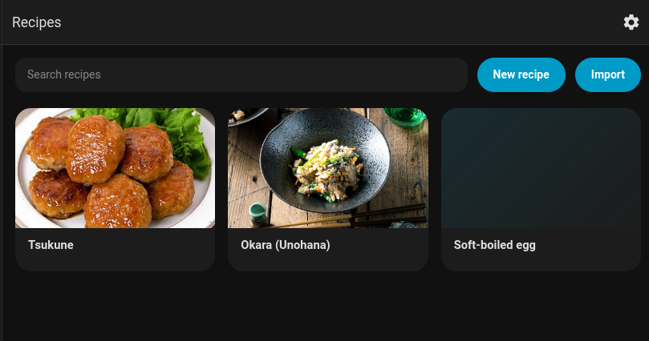
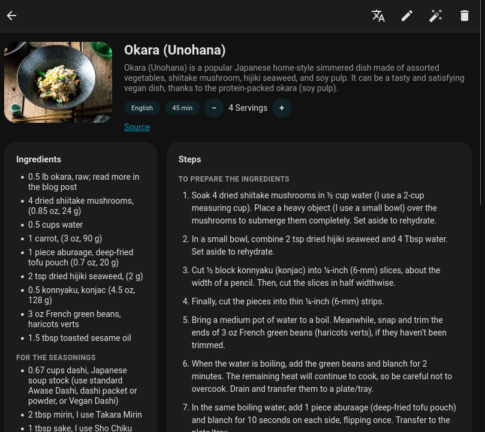
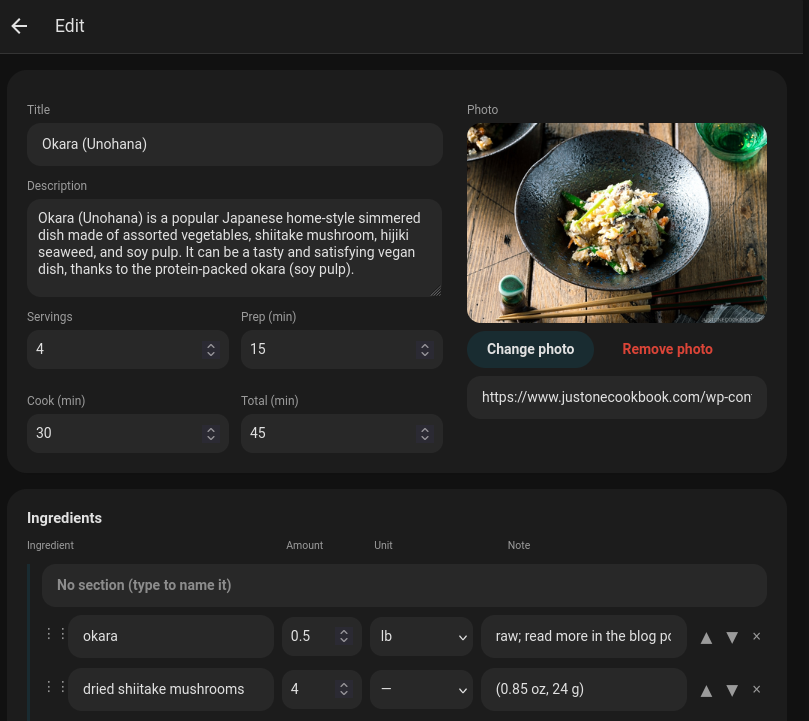

# Itadaki

A multilingual recipe app for Home Assistant. Keep recipes in any language, import them
from recipe sites, and translate or adapt them with an optional AI provider.







## Install

[](https://my.home-assistant.io/redirect/hacs_repository/?owner=vinjex&repository=itadaki&category=integration)

1. Click the button above, or in HACS open ⋮ → Custom repositories and add
   `https://github.com/vinjex/itadaki` as an Integration.
2. Download Itadaki in HACS and restart Home Assistant.
3. Add the integration:

   [](https://my.home-assistant.io/redirect/config_flow_start/?domain=itadaki)

Itadaki then appears in the sidebar. Requires Home Assistant 2026.10 or newer.

## Setup

Everything is configured from the app's Manage page (the cog, admins only):

- **Languages**: the languages your ingredient and unit catalogs are named in, and the
  ones offered for translation.
- **AI** (optional): any OpenAI-compatible provider. Enter its API address, key and model.
  Without AI, recipes are written by hand, and imports work for sites that embed recipe
  data, with ingredient lines matched by hand.

For Cloudflare Workers AI with a Gemma model, turn off its thinking mode under
Advanced → extra request fields, or answers get slow and time out:

```json
{"chat_template_kwargs": {"enable_thinking": false}}
```

Recipes are stored in one SQLite file in Home Assistant's config folder, so Home Assistant
backups include them.

## License

[MIT](LICENSE)
