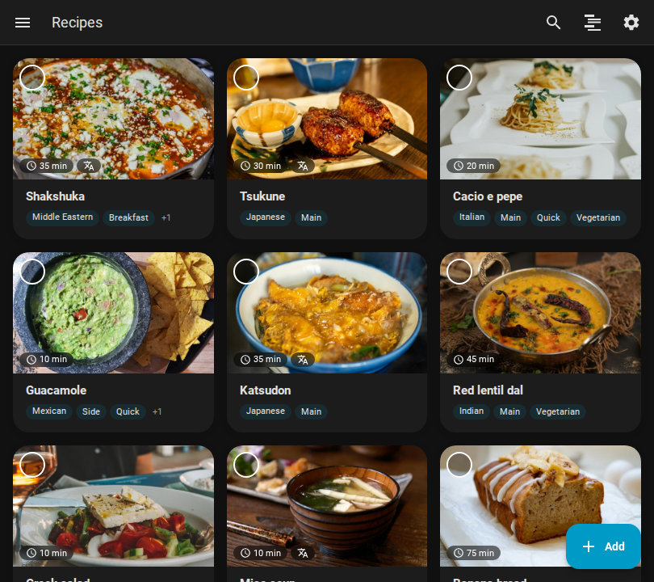

# Itadaki

A multilingual recipe app for Home Assistant. Keep recipes in any language, import them
from recipe sites, scale them, send ingredients to your shopping list, and translate or
adapt them with an optional AI provider.

## Install

1. Click the button above, or in HACS open ⋮ → Custom repositories and add
   `https://github.com/vinjex/itadaki` as an Integration.
2. Download Itadaki in HACS and restart Home Assistant.
3. Add the integration:

   

Itadaki then appears in the sidebar. Requires Home Assistant 2026.10 or newer.

## Documentation

- [Getting started](docs/getting-started.md)
- [Recipes](docs/recipes.md) and [finding them](docs/finding-recipes.md)
- [Importing from the web](docs/import.md)
- [AI](docs/ai.md), and [reviewing what it drafts](docs/review.md)
- [Translations and variants](docs/translations.md)
- [Ingredients, units and tags](docs/catalogs.md)
- [Shopping list](docs/shopping-list.md)
- [Photos and storage](docs/storage.md)
- [Automations and MCP](docs/automation.md)

## License

[MIT](LICENSE)
