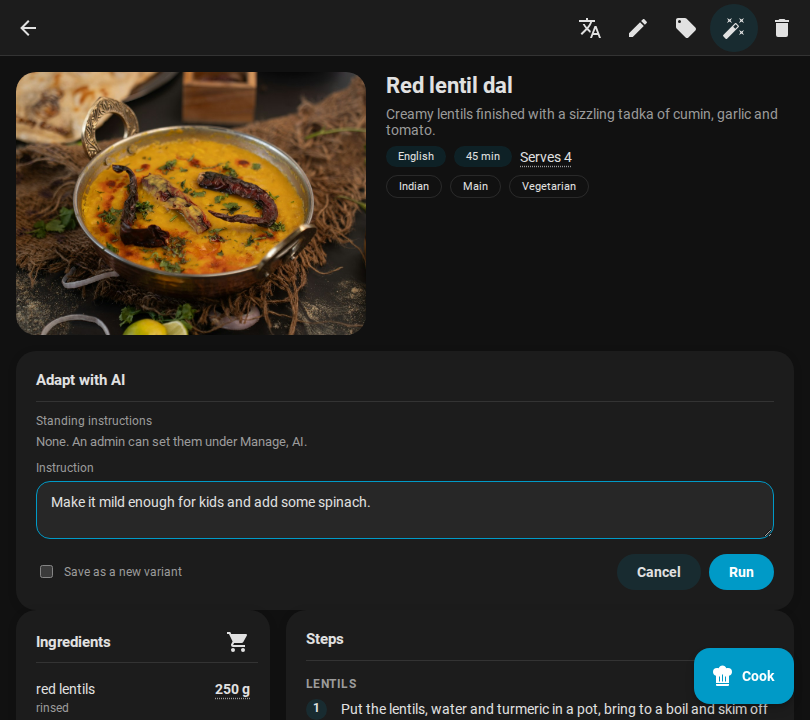
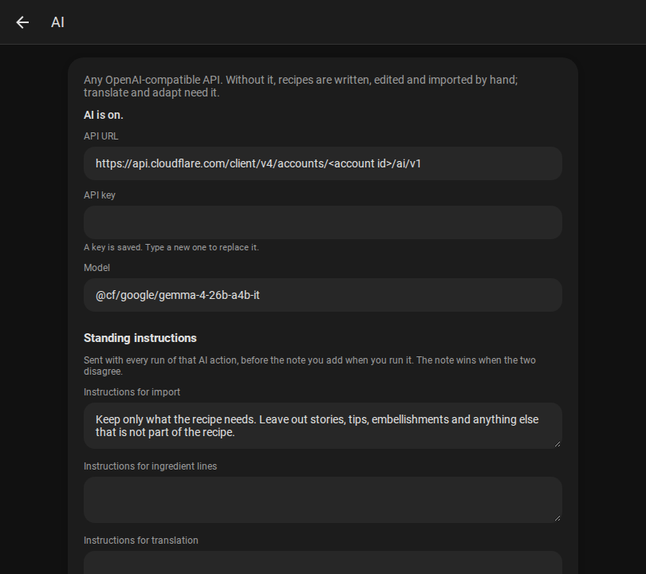

# AI

AI is optional. With a provider connected, Itadaki can:

- import pages without recipe data,
- match imported ingredient lines to your catalog,
- translate recipes into your library languages,
- adapt a recipe to an instruction ("make it vegetarian", "use metric", "halve the sugar"),
- suggest tags.

Nothing runs by itself. Every AI action starts from a card that shows the standing
instructions for that action and takes a note for this run; adapting needs one.



Every result comes back as a draft for you to check. See [Drafts and review](review.md).

## Connecting a provider

Itadaki works with any OpenAI-compatible API. On Manage → AI, enter the API address, key and
model. The key is stored in Home Assistant, not in the recipe database, and is never shown
again once saved.



### Cloudflare Workers AI

A cheap option with good Japanese and English.

- **API URL**: `https://api.cloudflare.com/client/v4/accounts/<account id>/ai/v1`, with your
  account id from the Cloudflare dashboard.
- **API key**: a Cloudflare API token with Workers AI permission.
- **Model**: `@cf/google/gemma-4-26b-a4b-it`.
- **Advanced → JSON enforcement**: JSON mode.
- **Advanced → Extra request fields (JSON)**: turn off the model's thinking mode, or answers get
  slow and time out:

  ```json
  {"chat_template_kwargs": {"enable_thinking": false}}
  ```

### Other providers

Any service with an OpenAI-style chat completions endpoint should work: OpenAI itself, a
local server such as Ollama or LM Studio, or a router like OpenRouter. If answers fail to
parse, try another JSON enforcement setting under Advanced. A different model per action can also be set
there.

## Standing instructions

Each action (import, ingredient lines, translation, adaptation) can have standing
instructions, set by an admin on the AI page, sent with every run. Use them for house rules
such as "always use metric units" or "keep Japanese measurements as they are". The note you
write when running an action comes after them and wins when the two disagree.

## Cost and speed

Itadaki keeps requests small: imports read embedded data without AI whenever it exists,
translations send only the text that changed since the last translation, and the AI never
receives your whole ingredient catalog. At most three AI jobs run at once; others wait their
turn.
