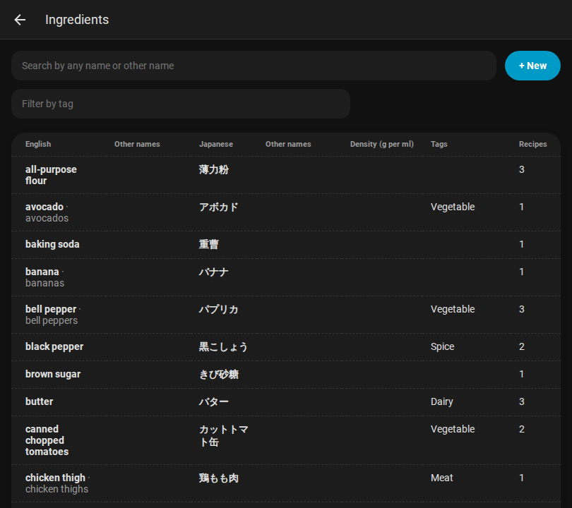

# Ingredients, units and tags

Recipes do not store ingredient names as text. Each line points to an entry in a shared
catalog, and each entry is named in every library language. That is what lets a recipe show
"玉ねぎ" in Japanese and "onions" in English from the same line, scale amounts, and build a
shopping list.

The catalogs are on the Manage page. Anyone can create a new ingredient while writing or
reviewing a recipe; editing, merging and deleting entries is for admins.

## Ingredients

Each ingredient has a name (and plural, where the language has one) in each library
language, plus other names: "scallion" can find "green onion". A word may mean only one
ingredient per language. Ingredients can carry tags, such as Vegetable or Dairy, which
[recipe filters](finding-recipes.md) also match, and a density for later weight and volume
conversion.

## Units

Units come preset: metric, US, imperial and Japanese measures, plus counts like clove and
pinch. Same-named units from different traditions are separate entries, since a US cup and a
Japanese cup differ. Add your own, such as "loaf", for yields and lines.

## Tags

Recipe tags (Italian, Dessert, Quick) and ingredient tags (Vegetable, Spice) are named in
every library language like the rest, so they show translated for free. Deleting a tag
removes it from everything that has it.

## Merging duplicates

When two entries mean the same thing, open the one to drop and use **Merge into another
entry**. Recipes switch to the one kept, and the dropped entry's names become its other names,
so the next import that says "scallion" finds it. Ingredients and units cannot be deleted
while a recipe uses them; merge them instead.
