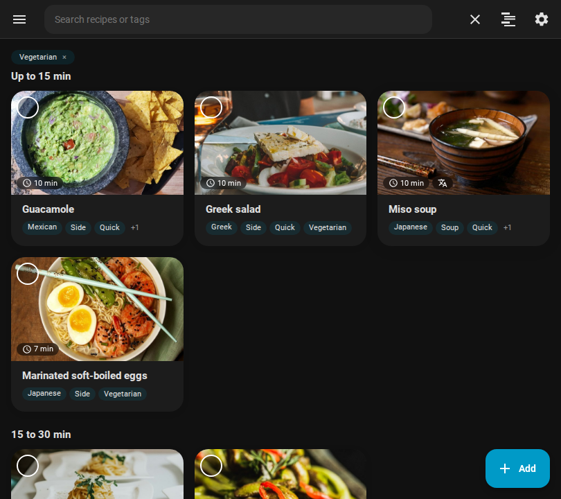
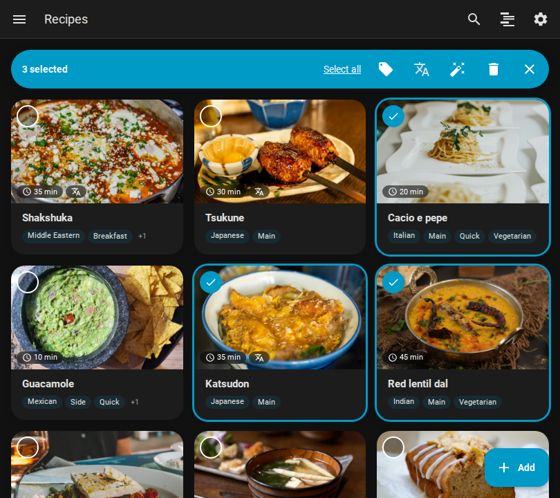

# Finding recipes

## Search and tag filters

The magnifier opens a search box. Typed text searches titles. Picking a suggested tag adds it
as a filter: a recipe must have every chosen tag. Filters also match the tags of the
ingredients a recipe uses, so an ingredient tag like "Dairy" finds every recipe with butter,
cream or feta.

## Grouping

The grouping button sorts the list into sections by recipe tag, language or cooking time. A
recipe with several tags shows under each of them.

The chosen filters and grouping are remembered on that device. Typed search text is not, so
a forgotten search never hides recipes the next day.

## Acting on many recipes

The circle on each card selects it. A bar then offers, for every selected recipe at once:
adding or removing tags (or letting the AI suggest them), translating, adapting with AI, and
deleting.

AI actions on a selection create one draft per recipe, each reviewed on its own. See
[Drafts and review](review.md).
