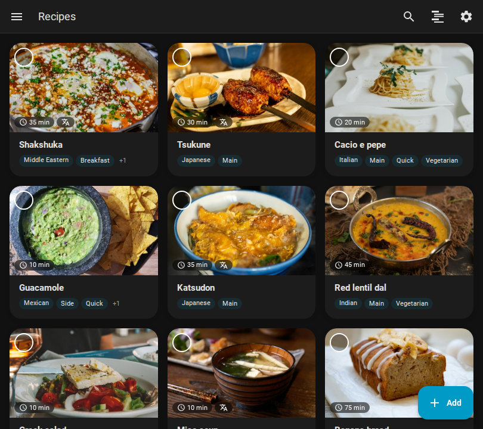
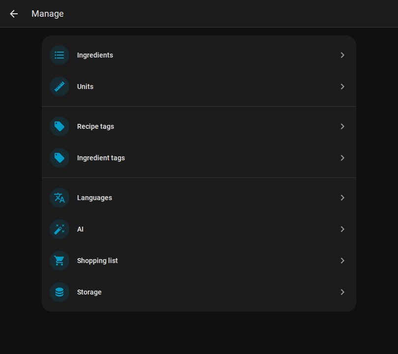
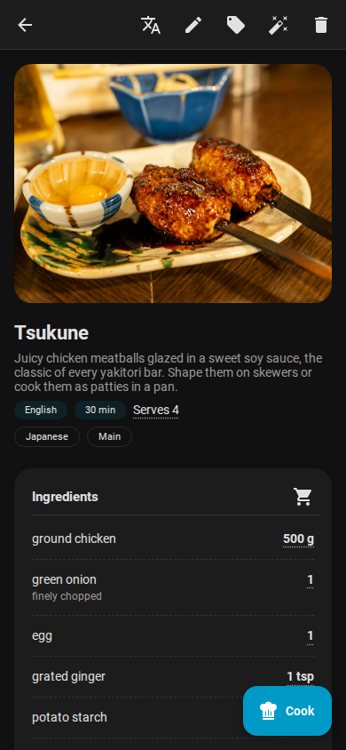

# Getting started

## Install

Itadaki installs through [HACS](https://hacs.xyz) as a custom repository.

1. In HACS open ⋮ → Custom repositories and add `https://github.com/vinjex/itadaki` as an
   Integration, or use the button in the [README](../README.md).
2. Download Itadaki in HACS and restart Home Assistant.
3. Go to Settings → Devices & services → Add integration and pick Itadaki. It asks nothing.

Itadaki then appears in the sidebar for every user. It needs Home Assistant 2026.10 or newer.

## First setup

Settings live on the Manage page, the cog at the top of the recipe list. Only Home
Assistant administrators see it; everyone else can read, write and import recipes.

- **Languages**: the languages your library works in. Every ingredient, unit and tag gets a
  name in each of them, and recipes can be translated into them. A new library starts with
  the language of the server and of every user. Removing a language later keeps the names
  already written in it.
- **AI** (optional): see [AI](ai.md). Without it, recipes are written, edited and imported
  by hand, and everything else works.
- **Shopping list**: which to-do list ingredients go to. See [Shopping list](shopping-list.md).

## On a phone

The panel works in the Home Assistant app. Recipes, cooking mode and the editor all fit a
phone screen.

## Where the data lives

Everything is in one SQLite file in Home Assistant's config folder, with photos next to it,
so Home Assistant backups include your recipes. See [Photos and storage](storage.md).
