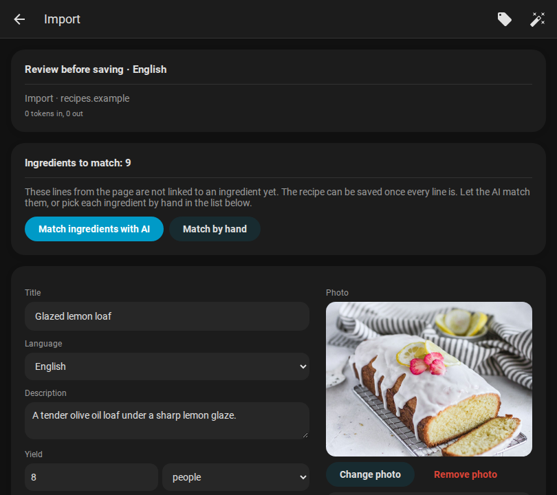

# Importing from the web

Use **Add** on the recipe list and paste the address of a recipe page.

Most recipe sites embed the recipe as structured data for search engines. Itadaki reads that
directly, without AI, and opens the result as a draft at once, with the page's photo saved
alongside. Keywords, category and cuisine on the page are linked to your existing tags.

The page's ingredient lines arrive as plain text ("1 lemon, zested and juiced"). Before the
recipe can be saved, each line is linked to an ingredient from your
[catalog](catalogs.md):

- **Match ingredients with AI** does them all at once, proposing new ingredients for any it
  does not know.
- **Match by hand** lets you pick each ingredient, amount and unit yourself.

Then review and save like any other draft. See [Drafts and review](review.md).

## Pages without recipe data

Some pages have no embedded data. Itadaki says so, and, if [AI](ai.md) is set up, offers
**Import with AI**: the AI reads the page text and writes the whole recipe. Its standing
instructions for import (on the AI page of Manage) default to leaving out stories and tips.
