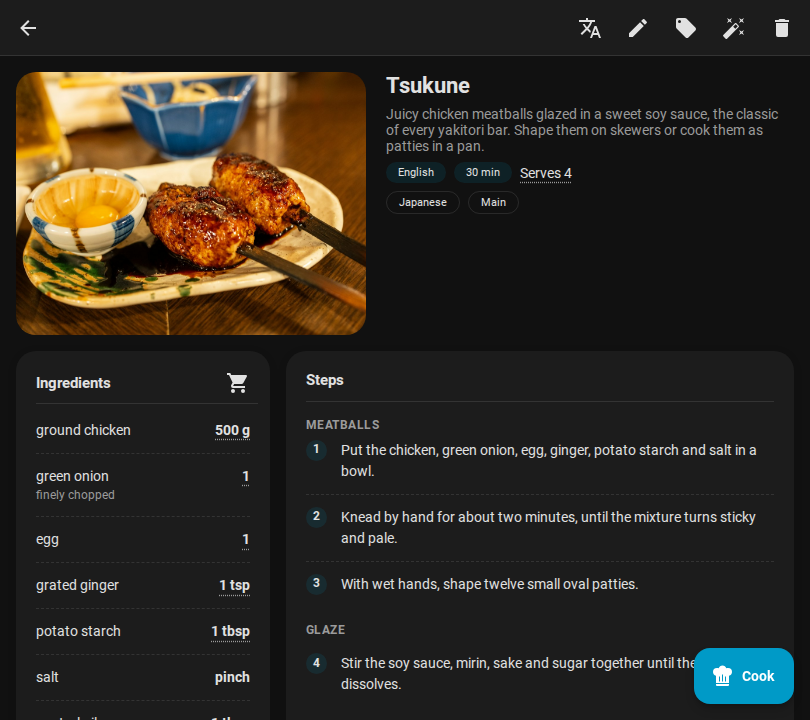
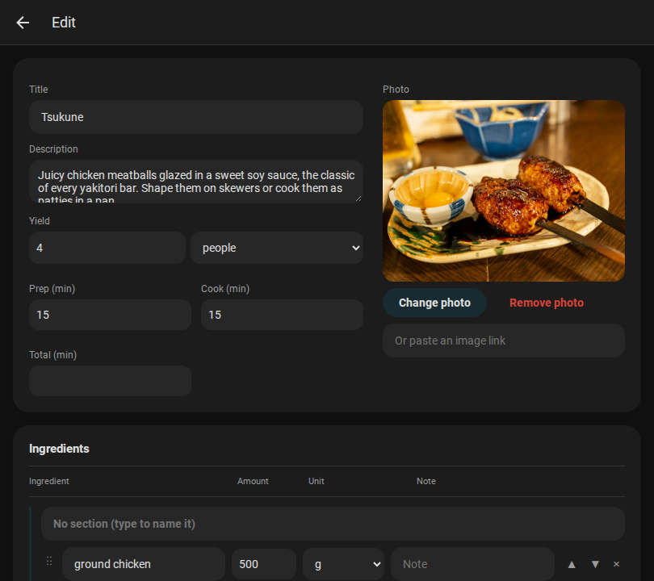

# Recipes

A recipe has a title, a description, a photo, a yield, prep, cook and total times, ingredient
lines, steps and notes. It is written in one language; other languages are
[translations](translations.md) of it.

## Writing and editing

Use **Add** on the recipe list, then **Write a recipe**, or the pencil on a recipe.

- **Ingredient lines** are always structured: an ingredient from the shared
  [catalog](catalogs.md), plus an optional amount, unit and note ("finely chopped"). Type to
  find an ingredient by any of its names in any language; a new one can be created on the spot.
  Because lines point to the catalog, a recipe shows ingredient names in its own language and
  can be scaled and turned into a shopping list.
- **Sections** group ingredients or steps under a heading, like "Glaze" or "Cooking". Steps
  and lines can be dragged, or moved with the arrows.
- **Yield** is how many people a recipe serves, or an amount with a unit from the catalog, such
  as "Makes 1 loaf" or "Makes 200 g".

## Scaling

Tap the yield to change it, or tap any ingredient amount and type the amount you have: every
line follows. Lines without an amount stay as they are. Scaling is a preview only; the recipe
itself is not changed. The scale is remembered per recipe on that device, and carries over
when you switch to a translation.

## Cooking mode

**Cook** shows only the ingredients and steps, in large type, and keeps the screen on while
it is open.

## Deleting

The bin icon deletes a recipe. A recipe that has translations or variants asks first, since
they go too.
