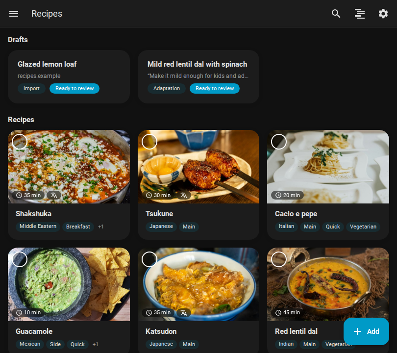
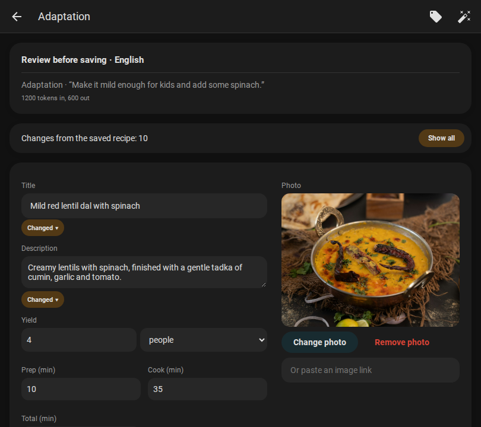
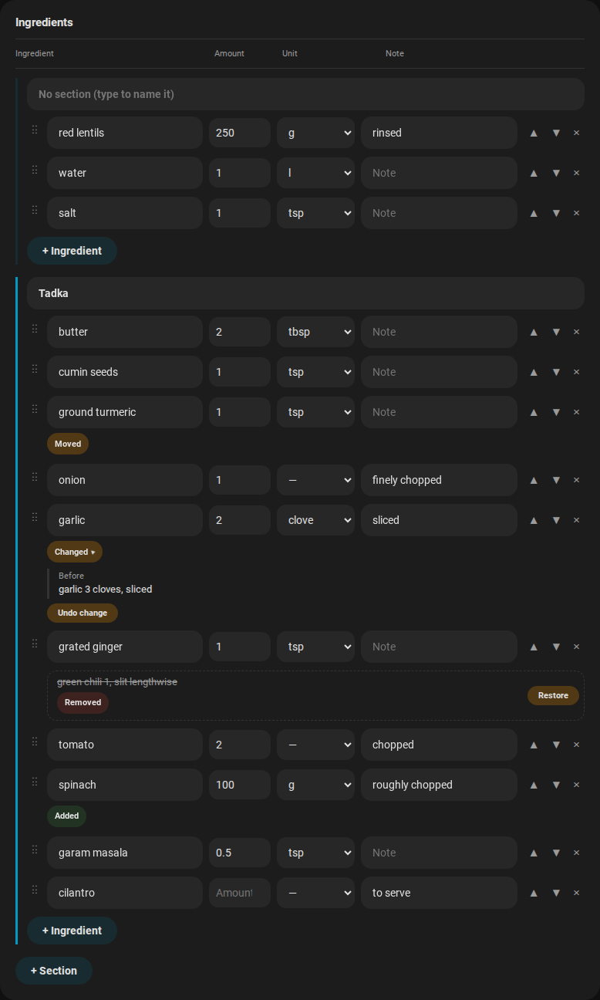

# Drafts and review

AI results and imports are never saved straight away. They land in the drafts inbox, at the
top of the recipe list, and run in the background: you can leave the page, close the app or
start more work meanwhile.

Each draft shows what was asked and where it stands: working, ready to review, or failed.
Work interrupted by an error or a restart keeps whatever it already produced, with the error
shown.

## Reviewing

Opening a ready draft shows the full editor, with everything editable before saving.

When the draft changes a recipe you already have, a bar on top counts the changes from the
saved recipe, and each changed field, line or step is marked right under it:

- **Changed** opens what it was before, with the words that changed highlighted, and
  **Undo change** to put it back.
- **Added** marks a new line or step.
- **Removed** keeps a dropped line or step in place, struck through, with **Restore**.
- **Moved** marks a line or step that only changed place.

**Show all** opens every change at once.

The count follows your edits as you type, so undoing a change lowers it. A new translation
shows the source text under each field instead.

From a draft you can also run more AI on it (adapt again, suggest tags) before saving.
**Save** applies it, including any new ingredients it proposes; **Discard** drops it.
