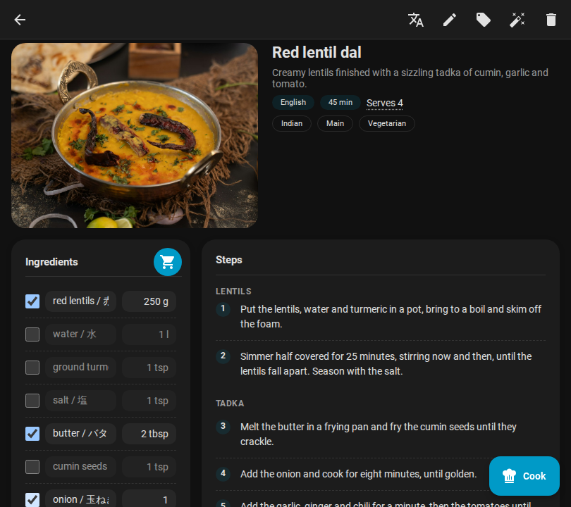

# Shopping list

The cart button on a recipe's ingredients turns them into a list to send to any Home
Assistant to-do list, such as the built-in Shopping list.

- Nothing is ticked at first: tick what you need to buy.
- Lines with the same ingredient and unit are added up, at the recipe's current
  [scale](recipes.md#scaling). Countable amounts are rounded up, so 1.5 onions become 2.
- Names are written in every library language ("onion / 玉ねぎ"), so everyone in the house
  can read the list. Names and amounts can be edited before adding.
- Items are added as "name (amount)".

An admin picks the default list on Manage → Shopping list. When there is more than one
to-do list, the list can also be chosen each time.
