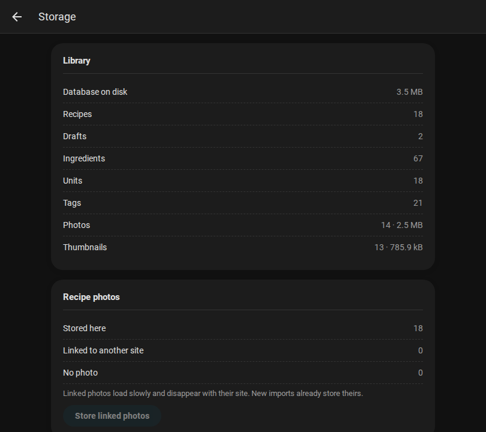

# Photos and storage

Recipes and catalogs live in one SQLite file, `itadaki.db`, in Home Assistant's config
folder, with photos beside it. Home Assistant backups include them.

## Photos

Photos are stored, not linked. An imported recipe's photo is downloaded, shrunk to at most
1600 pixels and saved; the same photo used twice is stored once. The recipe list loads small
thumbnails. You can also upload a photo or paste a link in the editor.

## The Storage page

Manage → Storage shows what the library holds and how much space it takes.

Recipes imported by older versions may still link to their photo on another site, which
loads slowly and disappears with the site. **Store linked photos** downloads and keeps them
all.
