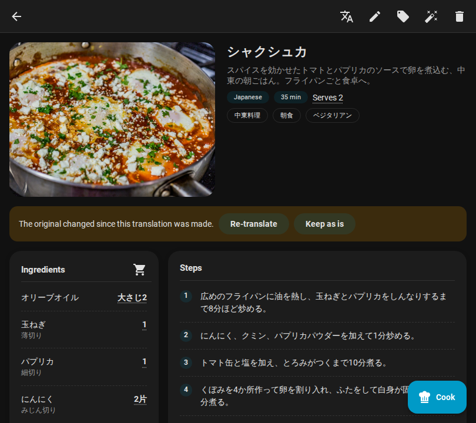

# Translations and variants

## Translations

A translation is the same dish in another language, with its own text. Ingredient names,
units and tags come from the shared [catalogs](catalogs.md), which are named in every library
language, so they never need translating and cost no AI.

The language icon on a recipe switches between its translations and, with [AI](ai.md) set
up, offers the missing library languages.

## Out-of-date translations

Editing the original marks its translations as out of date.

- **Re-translate** sends only the text that changed; everything already translated is
  reused. Hand edits made directly to the translation are replaced; the review shows what changes
  before anything is saved.
- **Keep as is** clears the mark without changing anything.

Edits never spread on their own: the original and its translations change only when you
change them. Tags are the one exception: they belong to the whole dish, so tagging any
translation tags them all.

## Variants

A variant is a different version of a dish: a vegetarian take, a quicker weeknight
version. It starts as a copy and then lives its own life, with its own tags. Variants show
on the recipe they come from, and carry a mark on their card.

Adapting a recipe with AI changes the recipe itself unless **Save as a new variant** is
ticked.
